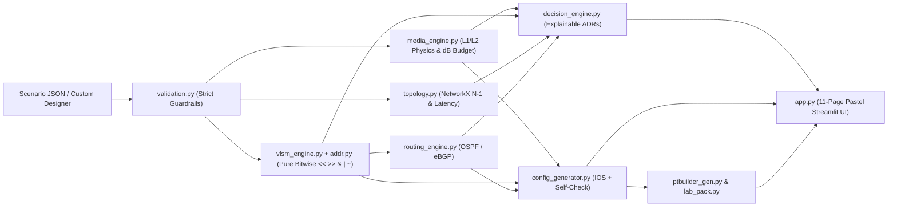

# NetArchitect — Algorithmic Enterprise Network Planner & Self-Explaining Cisco IOS Engine

**Student**: Sanju Madaan · **Enrollment / Roll No.**: `00714803124` · **Batch / Section**: `5C1`  
**Course**: CIC-307 Computer Networks Mini-Project  
**Stack**: Python 3.11+ · Streamlit · Pandas · Plotly · NetworkX · Pytest *(Zero external APIs or paid keys)*  

---

## 1. Overview, Problem Statement & Objectives

Designing enterprise networks manually across Campus LAN, Metro MAN rings, and Multi-City WANs is error-prone: engineers miscalculate VLSM block alignment, pick physical transceivers that exceed optical loss budgets, supply subnet masks instead of wildcard masks to OSPF, or leave switch trunks unrestricted across all VLANs.

**NetArchitect** eliminates ad-hoc guessing by combining six deterministic engines into one auditable studio:
1. **Physics-Validated Media Engine (`10 Gb/s`)**: Enforces Cat6a (`<=100 m`), OM4 MMF (`101–400 m`), and OS2 SMF (`>400 m`) boundaries, computing optical budgets (`km * dB/km + 2 * 0.3 dB connectors + extra splice loss`) with explicit exception classes (`PhysicalDistanceViolationError`, `OpticalBudgetError`).
2. **Pure Bitwise Integer VLSM Engine**: Computes masks, wildcards (`~mask & 0xFFFFFFFF`), gateways, broadcasts, natural block alignment (`network % size == 0`), and RFC 4632 contiguous group summaries using pure bitwise arithmetic (`<<`, `>>`, `&`, `|`, `~`). Python's `ipaddress` module is isolated strictly inside `tests/` as an independent verification oracle.
3. **Rule-Based Routing & Resiliency Engine**: Selects Single-Area OSPF (`<50 subnets`, 1 site), Multi-Area OSPF (`>=50 subnets` or multi-site), and eBGP (`RFC 4271` / `RFC 6996`), evaluates Collapsed-Core vs. Three-Tier hierarchy, and tests N-1 single-link failure survivability under latency objectives (`5 us/km + 50 us/hop`).
4. **Explainable Decision Engine (ADRs)**: Emits structured Architectural Decision Records (`reasoning`, `inputs_used`, `condition_triggered`, `standard_or_math_basis`) backed by IEEE/IETF RFCs and calculated numbers.
5. **Self-Checking Cisco IOS & PTBuilder Automation Generator**: Produces Packet Tracer (`--platform pt`) and native IOS configs with pre-export validation blocking duplicate IPs, overlapping blocks, wildcard drift, undefined ACLs, and OSPF/interface mismatches — plus ready-to-paste `ptbuilder_<preset>.js` scripts and reproducible `lab_guide.md` packs.
6. **Adversarial AI Audit Log**: Documents genuine defects discovered against the unreviewed draft (`git commit 8faf5edebdbb32725a9438c79fda4144001620e7`) alongside Layer 1–3 packet-flow analyses.

---

## 2. Rubric-to-Feature Traceability

| Weight | Rubric Component | Implementation Modules |
| :---: | :--- | :--- |
| **15 pts** | Parameter Engine + 3 Presets + Custom Validation | [scenarios/](file:///c:/Users/welcome/Downloads/sanjumadaan/scenarios/), [`validation.py`](file:///c:/Users/welcome/Downloads/sanjumadaan/engine/validation.py), [`errors.py`](file:///c:/Users/welcome/Downloads/sanjumadaan/engine/errors.py), [`page_custom.py`](file:///c:/Users/welcome/Downloads/sanjumadaan/ui/page_custom.py) |
| **25 pts** | Explainable Decision Engine (ADRs) | [`media_engine.py`](file:///c:/Users/welcome/Downloads/sanjumadaan/engine/media_engine.py), [`routing_engine.py`](file:///c:/Users/welcome/Downloads/sanjumadaan/engine/routing_engine.py), [`topology.py`](file:///c:/Users/welcome/Downloads/sanjumadaan/engine/topology.py), [`decision_engine.py`](file:///c:/Users/welcome/Downloads/sanjumadaan/engine/decision_engine.py) |
| **25 pts** | Bitwise VLSM (Zero Overlap) + Cisco IOS Configs | [`addr.py`](file:///c:/Users/welcome/Downloads/sanjumadaan/engine/addr.py), [`vlsm_engine.py`](file:///c:/Users/welcome/Downloads/sanjumadaan/engine/vlsm_engine.py), [`config_generator.py`](file:///c:/Users/welcome/Downloads/sanjumadaan/engine/config_generator.py), [`ptbuilder_gen.py`](file:///c:/Users/welcome/Downloads/sanjumadaan/engine/ptbuilder_gen.py) |
| **15 pts** | Unit Tests (Distance, Exhaustion, Edge Wildcards) | [`tests/`](file:///c:/Users/welcome/Downloads/sanjumadaan/tests/) (`test_media.py`, `test_vlsm.py`, `test_routing.py`, `test_topology.py`, `test_validation.py`, `test_config.py`, `test_ptbuilder.py`, `test_e2e.py`, `test_ui_smoke.py`) |
| **20 pts** | AI Audit Log (Two Real Flaws + Packet-Flow Trace) | [`ai_audit_log.md`](file:///c:/Users/welcome/Downloads/sanjumadaan/ai_audit_log.md), [`audit/raw/`](file:///c:/Users/welcome/Downloads/sanjumadaan/audit/raw/), [`page_audit.py`](file:///c:/Users/welcome/Downloads/sanjumadaan/ui/page_audit.py) |

---

## 3. System Architecture



---

## 4. Installation, CLI, Testing & Deployment

### Local Setup & Run
```bash
pip install -r requirements.txt
pytest -v
streamlit run app.py
```

### Command-Line Exports
```bash
python cli.py --preset campus --out exports/ --platform pt --emit-ptbuilder
python cli.py --preset man    --out exports/ --platform pt --emit-ptbuilder
python cli.py --preset wan    --out exports/ --no-crypto --platform pt --emit-ptbuilder
python cli.py --custom my_network.json --out exports/
```

### Streamlit Community Cloud Deployment
1. Push repository to GitHub (ensure `.streamlit/config.toml`, `app.py`, `requirements.txt`, `engine/`, `scenarios/`, `ui/`, `audit/`, `ai_audit_log.md`, and `lab/README.md` are tracked).
2. Open [share.streamlit.io](https://share.streamlit.io) -> **New App**.
3. Select repository/branch and set Main file path to **`app.py`**.
4. Click **Deploy** (uses zero secrets/API keys).

---

## 5. Screenshot Slots (For Final Lab Submission)
- `[ ]` **UI-01**: NetArchitect Pastel Dashboard & Address-Space Block Map (`VLSM Calculator`)
- `[ ]` **UI-02**: Interactive Network Topology Graph Colored by Medium (`Routing & Architecture`)
- `[ ]` **PT-01**: Campus LAN Packet Tracer Topology Green Links + Blocked WiFi->Server ACL Test
- `[ ]` **PT-02**: Metro MAN Failover Reconvergence (`show ip route` + `show ip ospf neighbor`)
- `[ ]` **PT-03**: Global WAN Multi-Area OSPF & `show ip bgp summary` (`AS 65001 <-> AS 65010`)

---

## 6. Stated Assumptions & Engineering Limitations
- **Optical Power Numbers**: Transceiver attenuation (`0.35` / `0.25 dB/km`), connector loss (`0.6 dB`), and power budgets (`6.2 / 10.9 / 23.0 dB`) are labeled as **typical datasheet values**; links exceeding 80 km recommend Carrier DWDM without unamplified optical claims.
- **Latency Objective**: Calculated `5 us/km + 50 us/hop` latency (`<= 5 ms` Metro MAN) is an **engineered design objective under uncontended forwarding assumptions**, never an unconditional carrier SLA guarantee.
- **Packet Tracer Dialect (`--platform pt`)**: Packet Tracer models `10G` optics as GigabitEthernet interfaces (recording real fiber/transceiver specifications in interface `description`), omits IPsec profiles when `--no-crypto` is passed, and requires manual `AC-POWER-SUPPLY` insertion on `3650-24PS` / `EHWIC` slot expansion on 4-port `2911` routers.
- **Verification Scope**: All configurations pass automated Python unit/self-check verification locally; Packet Tracer execution must be verified locally by the student following `lab/<preset>/lab_guide.md`.
